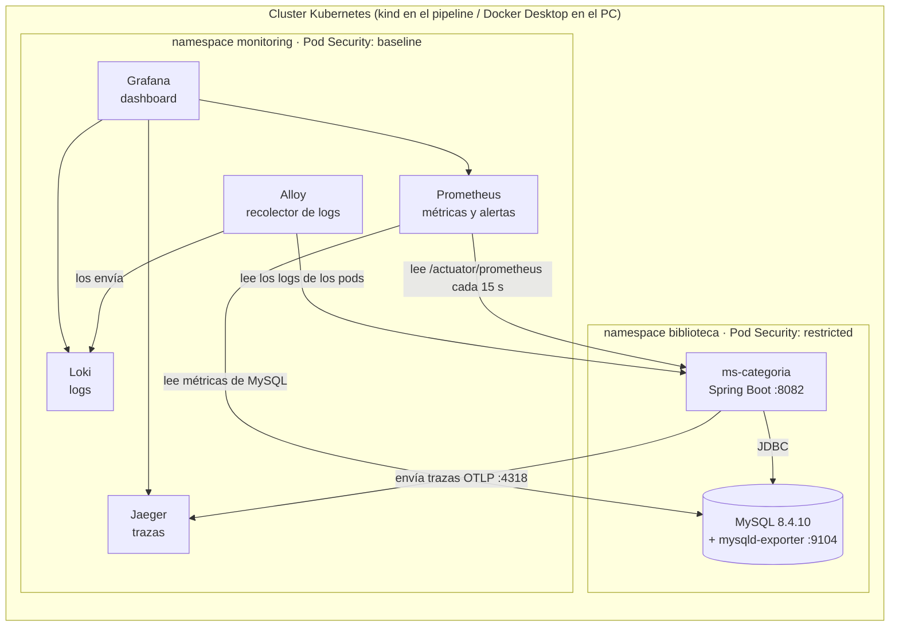
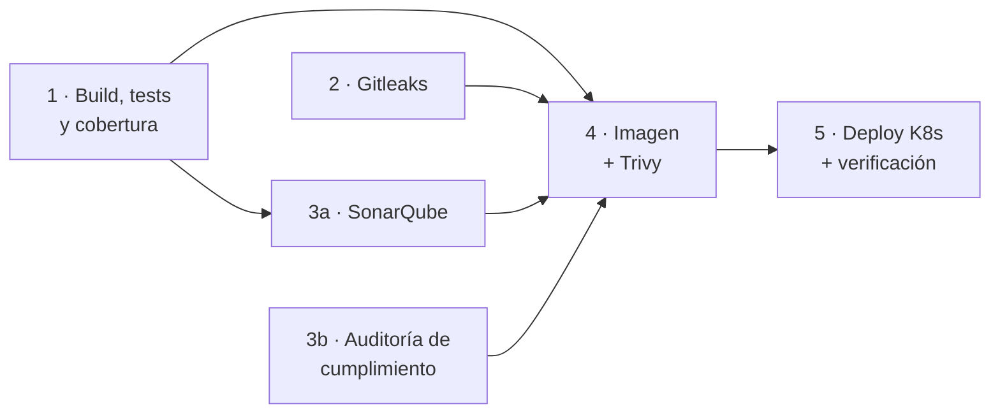

# ms_categoria · Microservicio de Categorías

Microservicio REST desarrollado para la asignatura de DevOps. Administra el catálogo de categorías de libros de la Biblioteca Online y se registra en Eureka para que los demás microservicios del sistema lo puedan descubrir.

Este README está dividido en tres partes: la [Evaluación Parcial 1](#evaluación-parcial-1) (microservicio, GitFlow y pipeline de integración continua básico), la [Evaluación Parcial 2](#evaluación-parcial-2) (contenedores, orquestación, pruebas con reportes, análisis de seguridad y publicación de la imagen) y la [Evaluación Parcial 3](#evaluación-parcial-3) (observabilidad, despliegue en Kubernetes y políticas de cumplimiento).

## Integrantes

- Abel Aylas
- Manuel Mora

## Contenido

**Evaluación Parcial 1**

- [De qué trata](#de-qué-trata)
- [Arquitectura](#arquitectura)
- [Cómo levantar el proyecto](#cómo-levantar-el-proyecto)
- [Cómo usar la API](#cómo-usar-la-api)
- [Documentación Swagger](#documentación-swagger)
- [Pruebas](#pruebas)
- [Pipeline CI/CD](#pipeline-cicd)
- [Estrategia de ramificación (GitFlow)](#estrategia-de-ramificación-gitflow)
- [Versionado con tags](#versionado-con-tags)
- [Tecnologías usadas](#tecnologías-usadas)
- [Uso de inteligencia artificial](#uso-de-inteligencia-artificial)

**Evaluación Parcial 2**


- [Contenedores: Dockerfile](#contenedores-dockerfile)
- [Orquestación con Docker Compose](#orquestación-con-docker-compose)
- [Pruebas automatizadas y reportes](#pruebas-automatizadas-y-reportes)
- [Pipeline CI/CD actualizado](#pipeline-cicd-actualizado)
- [Seguridad: SCA y SAST](#seguridad-sca-y-sast)
- [Publicación de la imagen](#publicación-de-la-imagen)
- [Trazabilidad y calidad](#trazabilidad-y-calidad)
- [Limitaciones y mejoras](#limitaciones-y-mejoras)
- [Tecnologías agregadas](#tecnologías-agregadas)
- [Uso de IA en esta evaluación](#uso-de-ia-en-esta-evaluación)
- [Conclusiones](#conclusiones)

**Evaluación Parcial 3**

- [De qué trata](#de-qué-trata-1)
- [Arquitectura](#arquitectura-1)
- [Decisión: Kubernetes local en vez de AWS](#decisión-kubernetes-local-en-vez-de-aws)
- [IE1: Monitoreo y logs](#ie1-monitoreo-y-logs)
- [IE2: Despliegue en Kubernetes](#ie2-despliegue-en-kubernetes)
- [IE3: Dashboards](#ie3-dashboards)
- [IE4: Cómo esto ayuda a tomar decisiones](#ie4-cómo-esto-ayuda-a-tomar-decisiones)
- [IE5: Políticas de cumplimiento](#ie5-políticas-de-cumplimiento)
- [IE6: El pipeline se detiene ante fallas](#ie6-el-pipeline-se-detiene-ante-fallas)
- [Problemas encontrados y cómo se resolvieron](#problemas-encontrados-y-cómo-se-resolvieron)
- [Uso de inteligencia artificial](#uso-de-inteligencia-artificial-1)
- [Reflexiones individuales](#reflexiones-individuales)

---

# Evaluación Parcial 1

## De qué trata

Cada libro de la biblioteca pertenece a una categoría según su estado o formato. Este microservicio permite crear, consultar, actualizar y eliminar esas categorías. Al arrancar, si la base de datos está vacía, carga cuatro categorías por defecto: **Nuevo**, **Usado**, **Reparado** y **Digital**.

Corre en el puerto **8082** y usa MySQL como base de datos (H2 en memoria para las pruebas).

## Arquitectura

El código sigue una arquitectura por capas: `Controller → Service → Repository → MySQL`, con un manejador global de errores que unifica el formato de las respuestas de fallo.

```
ms_categoria/
├── src/main/java/cl/syst3m64/categorias/
│   ├── CategoriasApplication.java   # Clase principal
│   ├── config/                      # Swagger y carga inicial de datos
│   ├── controller/                  # Endpoints REST
│   ├── exception/                   # Manejo global de errores
│   ├── model/                       # Entidad Categoria
│   ├── repository/                  # Acceso a datos (Spring Data JPA)
│   └── service/                     # Lógica de negocio
├── src/test/                        # Pruebas unitarias
├── Dockerfile
├── docker-compose.yml
└── .env.example                     # Plantilla de variables de entorno
```

## Cómo levantar el proyecto

### Sin Docker

Requiere Java 17 y un MySQL local con la base `bd_categorias` creada.

```bash
cd ms_categoria
export DB_USER=root DB_PASSWORD=tu_password EUREKA_CLIENT_ENABLED=false
./mvnw spring-boot:run
```

`DB_HOST`, `DB_PORT` y `DB_NAME` son opcionales y por defecto apuntan a `localhost:3306/bd_categorias`.

Para levantarlo con Docker Compose, ver [Orquestación con Docker Compose](#orquestación-con-docker-compose) en la Evaluación Parcial 2.

## Cómo usar la API

Ruta base: `http://localhost:8082/api/category`

| Método | Ruta | Descripción | Respuestas |
|---|---|---|---|
| GET | `/api/category` | Lista todas las categorías | 200 |
| GET | `/api/category/{id}` | Busca una categoría por ID | 200, 404 |
| GET | `/api/category/nombres?nombre=Nuevo` | Busca categorías por nombre | 200 |
| POST | `/api/category` | Crea una categoría | 201, 400 |
| PUT | `/api/category/{id}` | Actualiza una categoría | 200, 400, 404 |
| DELETE | `/api/category/{id}` | Elimina una categoría | 200, 404 |

Ejemplo de body para POST y PUT:

```json
{
  "nombre": "Ciencia Ficción",
  "descripcion": "Libros de ciencia ficción y tecnología"
}
```

Reglas de validación:

| Campo | Regla |
|---|---|
| `id` | Lo genera la base de datos. Si se envía en el body, la API responde 400 |
| `nombre` | Obligatorio, único, máximo 100 caracteres |
| `descripcion` | Opcional, máximo 300 caracteres |

Los errores de validación devuelven un JSON con el detalle por campo:

```json
{
  "timestamp": "2026-10-24T12:00:00",
  "status": 400,
  "error": "Validation Failed",
  "errors": { "nombre": "El nombre es obligatorio" }
}
```

## Documentación Swagger

Con el servicio levantado:

- Swagger UI: http://localhost:8082/swagger-ui.html
- OpenAPI JSON: http://localhost:8082/v3/api-docs

## Pruebas

En esta evaluación el proyecto contaba con **11 pruebas unitarias** escritas con JUnit 5 y Mockito. Las pruebas usan el perfil `test` con H2 en memoria, así que no necesitan MySQL.

```bash
cd ms_categoria
./mvnw test
```

| Clase | Qué prueba | Tests |
|---|---|---|
| `CategoriaControllerTest` | Endpoints REST (`@WebMvcTest`) | 2 |
| `CategoriaServiceTest` | Lógica de negocio con el repositorio simulado | 3 |
| `CategoriaRepositoryTest` | Consultas JPA contra H2 (`@DataJpaTest`) | 5 |
| `EspeciesApplicationTests` | Carga del contexto de Spring | 1 |
| **Total** | | **11** |


## Pipeline CI/CD

El workflow está en `.github/workflows/maven.yml`.

**Triggers**

| Evento | Rama | Propósito |
|---|---|---|
| `push` | `develop` | Valida cada funcionalidad integrada |
| `pull_request` | `main` | Valida los PR de release o hotfix antes de pasar a producción |

**Pasos**

| # | Paso | Detalle |
|---|---|---|
| 1 | Checkout | Descarga el código del repositorio |
| 2 | Verificación | Muestra la estructura del proyecto con `tree` |
| 3 | JDK 17 | Configura Temurin 17 con caché de Maven |
| 4 | Build y pruebas | `mvn -B package`: compila y ejecuta las pruebas unitarias |
| 5 | Resultado | Mensaje de éxito si el build y las pruebas pasan |

En esta evaluación el pipeline no corría sobre `main` directamente: como equipo primero validábamos cada cambio en `develop` antes de hacer un release a producción. En la Evaluación Parcial 2 se agregó el push a `main` (ver [Pipeline CI/CD actualizado](#pipeline-cicd-actualizado)).

**Incidencias resueltas**

- **Error de compilación:** la primera ejecución falló porque quedó un conflicto de merge sin resolver en `CategoriaService`, y las pruebas no alcanzaron a correr. Se corrigió en la rama `fix/conflicto-merge-categoriaservice`.

## Estrategia de ramificación (GitFlow)

Usamos GitFlow porque es un proyecto colaborativo con ciclos de desarrollo planificados.

| Rama | Origen | Propósito |
|---|---|---|
| `main` | — | Código en producción. Solo recibe cambios vía Pull Request desde `develop` (release) o `hotfix/*` |
| `develop` | `main` | Rama de integración donde se combinan las nuevas funcionalidades |
| `feature/*` | `develop` | Desarrollo de una funcionalidad nueva. Temporal, se elimina al fusionar |
| `docs/*` | `develop` | Cambios de documentación |
| `fix/*` | `develop` | Corrección de errores detectados durante la integración |
| `hotfix/*` | `main` | Corrección urgente de un bug en producción. Se fusiona en `main` y `develop` |

### Flujo de trabajo

1. Se crea una rama `feature/*` desde `develop`, por ejemplo `feature/validacion-datos` o `feature/actualizacion-endpoint`.
2. Al terminar la funcionalidad se abre un Pull Request hacia `develop`.
3. El otro integrante revisa y aprueba el PR antes del merge.
4. Cuando `develop` acumula cambios aprobados, se abre un PR `develop → main` (release).
5. Si ocurre un error en producción, se crea una rama `hotfix/*` desde `main`, se corrige y se fusiona con `main` y `develop` para mantener ambas al día.

### Por qué GitFlow

1. **`main` siempre estable:** la rama de producción se mantiene limpia mientras `develop` concentra las funcionalidades nuevas.
2. **Trabajo en paralelo:** con ramas `feature/*` independientes, cada integrante desarrolló su parte sin interferir con el otro: `feature/actualizacion-endpoint` (Abel Aylas) y `feature/validacion-datos` (Manuel Mora).
3. **Corrección rápida de errores:** las ramas `hotfix/*` permiten arreglar fallos críticos directamente desde `main`.
4. **Revisión entre pares:** cada Pull Request es revisado por el otro integrante, lo que reduce el riesgo de errores.

### Comandos principales

Feature (desde `develop`):

```bash
git checkout develop
git pull origin develop
git checkout -b feature/validacion-datos
git add .
git commit -m "feat: Se agrega validación de datos en el service"
git push -u origin feature/validacion-datos
# Se abre el Pull Request feature/validacion-datos → develop
```

Hotfix (desde `main`):

```bash
git checkout main
git pull origin main
git checkout -b hotfix/arreglo-validacion
git add .
git commit -m "fix: Se corrige validación en obtenerPorId"
git push -u origin hotfix/arreglo-validacion
# Se abre el Pull Request hotfix/arreglo-validacion → main
```

Los commits siguen el formato de Conventional Commits (`feat:`, `fix:`, `docs:`, `ci:`).

## Versionado con tags

Usamos tags anotados para marcar las versiones del proyecto:

| Tag | Descripción |
|---|---|
| `v1.0` | Versión base del microservicio |
| `v1.1` | Hotfix de un bug crítico en la validación por ID |

```bash
git checkout main
git pull origin main
git tag -a v1.1 -m "Hotfix de validación por ID"
git push origin v1.1
```

## Tecnologías usadas

| Área | Tecnología |
|---|---|
| Lenguaje y framework | Java 17, Spring Boot 4.0.6 |
| Persistencia | Spring Data JPA, MySQL 8, H2 (pruebas) |
| Microservicios | Spring Cloud Netflix Eureka Client |
| Validación y documentación | Spring Validation, Springdoc OpenAPI (Swagger) |
| Pruebas | JUnit 5, Mockito |
| CI/CD | GitHub Actions |
| Utilidades | Lombok, Maven |

## Uso de inteligencia artificial

Usamos Claude como apoyo durante el desarrollo: para sugerencias de comandos, para entender mejor el flujo de GitFlow, como ayuda en la redacción y para recibir sugerencias y feedback sobre el pipeline a implementar.

------------------------------------------------------------------------------------------------------------------

# Evaluación Parcial 2

Esta parte es la continuación de la Evaluación Parcial 1. Sobre el mismo microservicio ms_categoria automatizamos su ciclo de vida con contenedores, orquestación, pruebas con reportes, análisis de seguridad y publicación de la imagen docker. Seguimos un flujo de lo más básico a lo más complejo: primero el Dockerfile, luego Docker Compose y finalmente el pipeline, al que le fuimos agregando pruebas, reportes, seguridad y la publicación de la imagen.

## Contenedores: Dockerfile

El Dockerfile viene desde la versión base del microservicio. En esta evaluación lo integramos al flujo completo: Docker Compose lo usa para construir el servicio `categorias` y el pipeline lo usa para construir y publicar la imagen.

Usa un build en dos etapas (multi-stage):

| Etapa | Imagen base | Qué hace |
|---|---|---|
| `build` | `eclipse-temurin:17-jdk-alpine` | Instala Maven, descarga las dependencias y compila el JAR |
| runtime | `eclipse-temurin:17-jre-alpine` | Copia solo el JAR desde la etapa `build` y lo ejecuta en el puerto 8082 |

Detalles de la construcción:

- **Imagen final liviana:** la etapa final solo tiene el JRE y el JAR. Maven, el JDK y el código fuente quedan fuera de la imagen.
- **Caché de dependencias:** primero se copia `pom.xml` y se ejecuta `mvn dependency:go-offline`; después se copia `src`. Si solo cambia el código, Docker reutiliza la capa con las dependencias ya descargadas.
- **`-DskipTests`:** las pruebas no se repiten dentro del build de la imagen porque ya se ejecutan en el pipeline antes de construirla.
- **`ENTRYPOINT ["java","-jar","app.jar"]`:** en formato exec, Java recibe directamente las señales de Docker y se detiene limpiamente.

Construir la imagen localmente:

```bash
docker build -t ms-categoria ./ms_categoria
```

## Orquestación con Docker Compose

`ms_categoria/docker-compose.yml` levanta el microservicio junto a su base de datos en una red interna. Los servicios se comunican por nombre: el microservicio se conecta a MySQL usando `DB_HOST: mysql`.

| Servicio | Imagen | Puerto | Detalle |
|---|---|---|---|
| `mysql` | `mysql:8` | 3306 | Healthcheck con `mysqladmin ping` cada 10 s (5 reintentos) y volumen `mysql_datos` para persistir los datos |
| `categorias` | Build local con el Dockerfile | 8082 | Arranca solo cuando MySQL está sano (`depends_on` con `condition: service_healthy`) |

- **Healthcheck:** MySQL se marca como `healthy` solo cuando responde al ping. En el comando se usa `$$MYSQL_ROOT_PASSWORD` para que Compose no reemplace la variable y la expanda el shell dentro del contenedor.
- **Orden de arranque:** `condition: service_healthy` evita que el microservicio intente conectarse antes de que la base de datos esté lista.
- **Persistencia:** el volumen `mysql_datos` conserva los datos aunque se eliminen los contenedores.
- **Eureka:** se desactiva con `EUREKA_CLIENT_ENABLED=false`, porque en este Compose no se levanta un servidor Eureka.

### Variables de entorno

Las credenciales no están escritas en el código ni en el `docker-compose.yml`: se leen desde el archivo `.env`, que está en `.gitignore` y no se sube al repositorio. El archivo `.env.example` sirve de plantilla.

| Variable | Descripción | Valor de ejemplo |
|---|---|---|
| `MYSQL_ROOT_PASSWORD` | Contraseña del usuario root de MySQL | `cambiar_root` |
| `MYSQL_DATABASE` | Nombre de la base de datos | `bd_categorias` |
| `MYSQL_USER` | Usuario con el que se conecta el microservicio | `categorias` |
| `MYSQL_PASSWORD` | Contraseña de ese usuario | `cambiar_password` |
| `EUREKA_CLIENT_ENABLED` | Registro en Eureka (`false` si se levanta solo este servicio) | `false` |

### Cómo levantarlo

Solo se necesita tener Docker Desktop instalado.

```bash
cd devops_007d_ols/ms_categoria
docker compose up --build
```


| Acción | Comando |
|---|---|
| Ver el estado de los servicios | `docker compose ps` |
| Ver los logs del microservicio | `docker compose logs -f categorias` |
| Detener | `docker compose down` |
| Empezar de cero (borra la base de datos) | `docker compose down -v` |


## Pruebas automatizadas y reportes

En esta evaluación ampliamos las pruebas de 11 a **32**, escritas con JUnit 5 y Mockito. Usan el perfil `test`,
cuando teniamos 11 test, teniamos muy poca porcentaje de cobertura, Usamos IA  de forma etica para aumentar la cantidad de test, para aumentar el porcentaje de cobertura, permitiendo asi implementar bien el pipeline con jacoco.

### Reportes

| Reporte | Qué muestra | Comando local | Archivo |
|---|---|---|---|
| Surefire | Resultado de cada prueba: si pasó, falló o se omitió, y su duración | `./mvnw test surefire-report:report-only` | `target/reports/surefire.html` |
| JaCoCo | Cobertura de código: qué líneas y ramas recorren las pruebas | `./mvnw test` | `target/site/jacoco/index.html` |

En el pipeline ambos reportes se publican como artifacts (`Reporte-Pruebas` y `Jacoco-Reporte`). Para descargarlos: pestaña **Actions** → elegir una ejecución → sección **Artifacts** al final de la página (se necesita iniciar sesión en GitHub). Cada ejecución genera sus propios reportes.

### ¿Qué pasa si una prueba falla?

- Las pruebas se ejecutan en el paso `mvn -B package` del pipeline.
- Si una prueba falla, Maven termina con `BUILD FAILURE`  y el job queda en rojo.
- Se saltan los pasos siguientes: el análisis de SonarQube, el login y la publicación de la imagen. **Una versión con pruebas fallidas nunca se publica.**
- Solo se generan y suben los reportes de pruebas (`if: always()`), para revisar qué prueba falló.

## Pipeline CI/CD actualizado

El workflow sigue en `.github/workflows/maven.yml`. Respecto a la Evaluación Parcial 1 se agregaron los reportes, el análisis de SonarQube con su alerta, la construcción y publicación de la imagen docker, los permisos del token y el trigger de push a `main`.

**Triggers**

| Evento | Rama | Qué hace |
|---|---|---|
| `push` | `develop` | Pruebas, reportes y publicación de la imagen |
| `push` | `main` | Pruebas, reportes, análisis SonarQube y publicación de la imagen |
| `pull_request` | `main` | Pruebas, reportes y análisis SonarQube. No publica la imagen |

**Permisos y secretos**

| Elemento | Valor | Uso |
|---|---|---|
| `permissions` | `contents: read`, `packages: write` | Mínimo privilegio: el token solo puede leer el código y publicar en GHCR |
| `SONAR_TOKEN` | Secret del repositorio | Autenticación con SonarQube Cloud |
| `GITHUB_TOKEN` | Generado automáticamente en cada ejecución | Login en `ghcr.io` |

**Pasos**

| # | Paso | Detalle |
|---|---|---|
| 1 | Checkout | Descarga el código con historial completo (`fetch-depth: 0`), necesario para SonarQube |
| 2 | Verificación | Muestra la estructura del proyecto con `tree` |
| 3 | JDK 17 | Configura Temurin 17 con caché de Maven |
| 4 | Build y pruebas | `mvn -B package`: compila, ejecuta las pruebas y genera el reporte JaCoCo |
| 5 | Resultado | Mensaje de éxito |
| 6 | Reporte JaCoCo | Sube el reporte de cobertura como artifact `Jacoco-Reporte` |
| 7 | Reporte de pruebas | Genera el HTML de Surefire aunque alguna prueba falle (`if: always()`) |
| 8 | Subir reporte de pruebas | Sube el reporte como artifact `Reporte-Pruebas` (`if: always()`) |
| 9 | Análisis SonarQube Cloud | Solo en PR o en `main`, nunca en ejecuciones de Dependabot. Espera el Quality Gate (`sonar.qualitygate.wait=true`) y falla si no se aprueba |
| 10 | Alerta si falla SonarQube | Solo si falla el paso 9: deja un resumen en la ejecución y una anotación de error |
| 11 | Login a ghcr.io | Autenticación con `GITHUB_TOKEN` (solo en push) |
| 12 | Nombre de imagen en minúsculas | Convierte el nombre del repositorio a minúsculas, porque ghcr.io no acepta mayúsculas |
| 13 | Build y push | Construye la imagen con el Dockerfile y la publica en `ghcr.io` (solo en push) |


**Incidencias resueltas**

- **Publicación en ghcr.io:** el primer intento falló porque `docker/login-action@v6` no existe (la versión estable es `v4`), el registro estaba escrito como `ghcr:io` y ghcr.io no acepta mayúsculas en el nombre de la imagen. Se corrigió en `feature/pipeline-docker`, usando además `docker/build-push-action@v7` y un paso que convierte el nombre a minúsculas.

## Seguridad: SCA y SAST

El pipeline combina dos tipos de análisis: **SAST** (análisis estático del código propio) con SonarQube Cloud y **SCA** (análisis de las dependencias de terceros) con Dependabot.

### SAST: SonarQube Cloud

| Elemento | Valor |
|---|---|
| Organización | `syst3m644` |
| Proyecto | `SYST3M644_devops_007d_ols` |
| Configuración | Propiedades `sonar.*` en `ms_categoria/pom.xml` |
| Token | Secret `SONAR_TOKEN` (nunca en el código) |
| Cuándo corre | Pull Requests hacia `main` y push a `main` |
| Qué analiza | Bugs, vulnerabilidades, security hotspots, code smells, duplicación y cobertura (desde JaCoCo) |
| Dashboard | https://sonarcloud.io/dashboard?id=SYST3M644_devops_007d_ols |


- **Dependabot:** el análisis se omite en las ejecuciones disparadas por Dependabot, porque GitHub no les entrega los secrets del repositorio y el análisis fallaría sin `SONAR_TOKEN`.

### SCA: Dependabot

Configurado en `.github/dependabot.yml`. Revisa las dependencias cada semana y abre Pull Requests hacia `develop`, respetando GitFlow.


Actualizaciones ya integradas:

| PR | Actualización |
|---|---|
| #24 | `jacoco-maven-plugin` → 0.8.15 |
| #25 | `spring-cloud-dependencies` → 2025.1.4 |
| #26 | `actions/upload-artifact` v6 → v7 |
| #27 | `apache-maven` → 3.10.0 |
| #28 | `springdoc-openapi-starter-webmvc-ui` → 3.1.1 |

### Otros controles de seguridad

- Permisos mínimos para el token del pipeline (`contents: read`, `packages: write`).
- Secretos fuera del código: `SONAR_TOKEN` en GitHub Secrets y credenciales de MySQL en `.env` (ignorado por Git).

### ¿Por qué usamos SCA y SAST?

Principalmente utilizamos SAST en sonarQube principalmente para monitoriar la calidad de nuestro codigo fuente, permitiendo detectar bugs, malas practicas y cobertura junto jacoco

Y por otro lado se opto por utilizar SCA con dependaBot, permitiendo detectar vulnerabilidades como librerias de terceros y generar Pull Request automatico a librerias seguras.

Porque se hizo asi, para viusalizar que nuestro microservicio cuente con la seguridad minima en el desarrollo.

## Publicación de la imagen

En cada push a `develop` o `main`, el pipeline construye la imagen con el Dockerfile y la publica en GitHub Container Registry. Se puede ver en la sección **Packages** del repositorio.

```bash
docker pull ghcr.io/syst3m644/devops_007d_ols:latest
```

- El login se hace con el `GITHUB_TOKEN` de la ejecución, sin credenciales personales.
- La imagen solo se publica si pasaron las pruebas (y el Quality Gate, cuando corre SonarQube).

## Trazabilidad y calidad

### Trazabilidad

Cada cambio se puede seguir desde el commit hasta la imagen publicada:

| Eslabón | Dónde se ve |
|---|---|
| Commit (Conventional Commits) | Historial de commits |
| Rama y Pull Request revisado | Pestaña Pull Requests |
| Ejecución del pipeline (commit, autor y logs de cada paso) | Pestaña Actions |
| Reportes de pruebas y cobertura | Artifacts de cada ejecución |
| Análisis de código | Historial en SonarQube Cloud |
| Imagen publicada | Packages (`ghcr.io`) |
| Versiones liberadas | Tags `v1.0` y `v1.1` |

Historial de cambios de esta evaluación:

| Fecha | Cambio | Rama / PR |
|---|---|---|
| 28-09-2026 | Docker Compose con MySQL | `feature/implementacion-docker-compose` (PR #12) |
| 12-10-2026 | Reporte JaCoCo en el pipeline y nuevas pruebas unitarias | `feature/implementacion-jacoco` |
| 24-10-2026 | Construcción y publicación de la imagen en ghcr.io | `feature/pipeline-docker` (PR #15) |
| 24-10-2026 | Variables de entorno con `.env` | `feature/variables-env` (PR #16) |
| 24-10-2026 | Reporte HTML de pruebas con Surefire | `feature/reporte-pruebas-html` (PR #19) |
| 26-10-2026 | SonarQube Cloud y Dependabot | `feature/sonarqube-cloud` (PR #21) |
| 26-10-2026 | Actualizaciones de dependencias de Dependabot | PRs #24 a #28 |

### Política de calidad

Un cambio solo avanza si cumple estas condiciones:

1. **Las pruebas pasan:** si una falla, el pipeline se detiene y no se publica la imagen.
2. **La cobertura se mide en cada build** con JaCoCo y queda como evidencia descargable.
3. **El Quality Gate de SonarQube se aprueba** en los Pull Requests hacia `main` y en `main`.
4. **Revisión entre pares:** cada Pull Request lo revisa el otro integrante antes del merge.

## Uso de IA en esta evaluación

Usamos Claude como apoyo para revisar el repositorio frente a la pauta de evaluación, recibir feedback sobre el pipeline y la configuración de Docker, preparar la defensa y redactar la documentación de este README, permitiendo mejora ortografica y sintaxis de README, que fue revisada y validada por el equipo. Las decisiones técnicas, las justificaciones y las reflexiones individuales son propias del equipo y se escribieron sin IA y sinceros sobre aprendizaje.


### Reflexión de Manuel Mora

Mi reflexion a esta experiencia de aprendizaje, es que aprendi como construir un docker compose ya sea configurarlo, construir una imagen, checkear el  healthcheck por ejemplo en este caso a mysql (base de datos), realizar volumenes directo en el .yml de compose y depends_on, Que semestre anterior no aprendi muy bien el concepto de docker, ahora a gracias a devops tengo conocimientos mas firmes sobre docker y me siento mas preparado.

Sobre el pipeline, aprendi construir o implementar reportes jacoco desde actions, y empaquetar y publicar una imagen docker. (Yo cause el error de la version v6), pero gracias a mi compañero abel, me ayudo solucionar la version y poder ejecutar correctamente el pipeline, permitiendo visualizar las pruebas unitarias gracias al reporte jacoco, junto el package en github de la imagen docker.

Sobre dependabot y sonarQube. Principalmente no fui directo en codigo, pero pude redactar su teoria, su importacia y como impacta como sus funciones etc. 

De todas formar visualize y apoye a mi compañero abel en el desarrollo de SAST Y SCA, aprendiendo como se construye paso a paso y como visualizar el dashboard que nos genera de nuestro proyecto.

### Reflexión de Abel Aylas

Aprendi a usar jacoco para validar la cobertura del codigo. Teniamos pocos test, por lo cual decidimos agregar mas test usando IA para tener mas cobertura del codigo, en la cual obtuvimos el 100%.

Y tambien aprendi a usar Dependabot como SCA para ver vulnerabilidades de codigo, y tambien SonarQube, que me sirvio para ver la calidad del codigo, en la cual detecto dos fallas o posibles vulneraciones sobre el ID, ya que el ID es un parametro que no puede viajar en JSON, y nos recomienda usar un DTO para que esos datos no viajen en el JSON.

Tambien con el apoyo de mi compañero Manuel, que con el pudimos implementar todo el sistema de Dockerfile. Me costo un poco integrarme a las clases, por eso no pude ver bien el Docker Compose o el empaquetado de imagen o el Pipeline de maven.yml, pero si recuerdo algo del semestre anterior sobre el empaquetado de imagen con Dockerfile. El apoyo de mi compañero Manuel fue fundamental para sacar el proyecto adelante.

---

# Evaluación Parcial 3

## De qué trata

La EP3 pedía que el microservicio se pudiera monitorear, desplegar de forma automática y controlar con políticas de cumplimiento. Sobre el mismo ms_categoria agregamos observabilidad (métricas, logs y trazas), un despliegue completo en Kubernetes que el pipeline hace solo en cada ejecución, y gates de seguridad y calidad que detienen el pipeline cuando algo no cumple.

## Arquitectura

> Diagrama elaborado con apoyo de IA (Claude) y revisado por el equipo.



| Componente | Imagen | Función |
|---|---|---|
| ms-categoria | `ghcr.io/syst3m644/devops_007d_ols:sha-<commit>` | El microservicio. Expone `/actuator/health`, `/actuator/info` y `/actuator/prometheus`, y envía sus trazas a Jaeger |
| MySQL | `mysql:8.4.10` | Base de datos, con un volumen persistente de 1 Gi |
| mysqld-exporter | `prom/mysqld-exporter:v0.21.0` | Contenedor *sidecar* junto a MySQL que publica sus métricas (`mysql_up`, conexiones, consultas) |
| Prometheus | `prom/prometheus:v3.15.1` | Recolecta métricas cada 15 s (app, MySQL y CPU/memoria de los contenedores) y evalúa 6 reglas de alerta |
| Alloy | `grafana/alloy:v1.21.3` | Descubre los pods, lee sus logs y los envía a Loki |
| Loki | `grafana/loki:3.6.22` | Guarda y permite consultar los logs |
| Jaeger | `jaegertracing/jaeger:2.20.0` | Recibe las trazas por OpenTelemetry (OTLP) y las muestra |
| Grafana | `grafana/grafana:13.0.12` | Dashboard del microservicio, con Prometheus, Loki y Jaeger como fuentes de datos |

Todos los servicios son `ClusterIP`: no quedan expuestos fuera del cluster. Para verlos desde el PC se usan túneles (`kubectl port-forward`) con `paneles.sh`.

## Decisión: Kubernetes local en vez de AWS

| Servicio de AWS | Para qué sirve | Lo que usamos en su lugar |
|---|---|---|
| Amazon EKS | Kubernetes administrado | Kubernetes local: `kind` en el pipeline y Kubernetes de Docker Desktop en el PC |
| CloudWatch Metrics y Alarms | Métricas y alarmas | Prometheus y sus reglas de alerta |
| CloudWatch Logs | Logs centralizados | Loki + Alloy |
| CloudWatch Dashboards | Paneles | Grafana |
| AWS X-Ray | Trazas distribuidas | Jaeger con OpenTelemetry |
| Amazon ECR | Registro de imágenes | GitHub Container Registry (`ghcr.io`) |
| AWS Secrets Manager | Secretos | Secrets de Kubernetes y GitHub Secrets |

> **Importante no se utilizo proceso en la nube, por simplemente la justificacion, no nos encontrabamos con credenciales y ademas si es un sistema de costeo** 

## IE1: Monitoreo y logs

**Qué se mide y dónde se ve**

| Qué se mide | Cómo se obtiene | Dónde se ve |
|---|---|---|
| Disponibilidad | `up{app="ms-categoria"}`, `mysql_up` y los probes de Kubernetes (`/actuator/health/liveness` y `readiness`) | Grafana (paneles Microservicio, MySQL y Tiempo activo) y Prometheus |
| Tráfico | `http_server_requests_seconds_count`: peticiones por segundo y por código HTTP | Grafana |
| Errores | Porcentaje de respuestas 4xx y 5xx, y logs WARN/ERROR del `GlobalExceptionHandler` | Grafana y Loki |
| Latencia | Histograma de `http.server.requests`: percentiles p50, p95 y p99 | Grafana |
| CPU y memoria | Métricas de cAdvisor por contenedor y uso del heap de la JVM | Grafana |
| Base de datos | Conexiones y consultas de MySQL (mysqld-exporter) | Grafana |
| Logs | En Kubernetes, la app escribe logs en JSON (formato ECS), una línea por evento y con su `traceId` | Loki, consultado desde Grafana |
| Trazas | Cada petición HTTP y sus consultas a la base, marcadas con la versión desplegada (`service.version`) | Jaeger (servicio `categorias`) |

Las rutas `/actuator` quedan fuera de las trazas y de la métrica de peticiones (`ObservabilidadConfig`), porque Prometheus y Kubernetes las consultan cada pocos segundos y taparían las peticiones reales.

**Cambios en el microservicio**

| Archivo | Cambio |
|---|---|
| `pom.xml` | Dependencias `spring-boot-starter-actuator`, `micrometer-registry-prometheus` y `spring-boot-starter-opentelemetry` |
| `application.yml` | Endpoints de Actuator (`health`, `info`, `prometheus`, `metrics`), probes, percentiles de latencia y configuración de trazas |
| `application-k8s.yml` | Perfil para Kubernetes: logs JSON, nivel INFO, readiness que incluye la base de datos y envío de trazas a Jaeger |
| `ObservabilidadConfig.java` | Excluye `/actuator` de trazas y métricas |
| `GlobalExceptionHandler.java` | Cada error que se responde también queda en el log (WARN para 400 y 404, ERROR para fallas no controladas) |

**Alertas configuradas en Prometheus**

| Alerta | Se activa cuando | Severidad |
|---|---|---|
| `MicroservicioCaido` | El microservicio no responde durante 1 min | critical |
| `MySQLCaido` | MySQL no responde durante 1 min | critical |
| `TasaErrores5xxAlta` | Más del 5% de las peticiones terminan en 5xx durante 2 min | critical |
| `TasaErrores4xxAlta` | Más del 20% de las peticiones terminan en 4xx durante 2 min | warning |
| `LatenciaP95Alta` | El p95 supera 1 segundo durante 5 min | warning |
| `MemoriaHeapAlta` | La JVM usa más del 90% del heap durante 5 min | warning |

## IE2: Despliegue en Kubernetes

**Carpeta `kubernetes/`**

| Archivo | Qué contiene |
|---|---|
| `00-namespaces.yaml` | Namespaces `biblioteca` (Pod Security `restricted`) y `monitoring` (`baseline`) |
| `app/ms-categoria.yaml` | ServiceAccount, Deployment (probes, recursos y seguridad) y Service del microservicio |
| `app/mysql.yaml` | Volumen persistente, Deployment de MySQL con el sidecar mysqld-exporter, y Service |
| `monitoring/prometheus-server.yaml` | Prometheus, qué métricas recolecta y las 6 reglas de alerta |
| `monitoring/alloy.yaml` | Alloy: descubre los pods, lee sus logs y los envía a Loki |
| `monitoring/loki.yaml` | Loki |
| `monitoring/jaeger.yaml` | Jaeger |
| `monitoring/grafana.yaml` | Grafana con sus fuentes de datos (Prometheus, Loki y Jaeger) |
| `monitoring/dashboards/ms-categoria.json` | Dashboard del microservicio |
| `desplegar.sh` | Despliega todo en 6 pasos y mide el tiempo de despliegue |
| `verificar.sh` | 12 verificaciones después del despliegue |
| `local.sh` | Construye la imagen y la despliega en el Kubernetes de Docker Desktop |
| `paneles.sh` | Abre túneles hacia la app, Grafana, Prometheus y Jaeger, y muestra la clave de Grafana |

**Despliegue automático en el pipeline (job 5)**

1. Crea un cluster Kubernetes temporal con `kind` dentro del runner de GitHub Actions.
2. Carga la **misma imagen** que construyó y escaneó el job 4 ("build once, deploy many").
3. Ejecuta `desplegar.sh`: namespaces, secretos con contraseñas aleatorias, stack de observabilidad, MySQL y microservicio. Si algo no queda listo a tiempo, el pipeline falla.
4. Ejecuta `verificar.sh`: 7 verificaciones del microservicio (health, readiness, GET 200, POST inválido 400, id inexistente 404, versión en `/actuator/info` y métricas) y 5 de observabilidad (app y MySQL en Prometheus, reglas de alerta cargadas, logs en Loki y trazas en Jaeger).
5. Deja un resumen con la imagen, el commit, el tiempo de despliegue, los pods y el historial de despliegues. Si falla, muestra el diagnóstico de los pods.

**Despliegue en el PC**

Requiere Docker Desktop con Kubernetes activado y Git Bash. Desde la raíz del repositorio:

```bash
./kubernetes/local.sh      # construye la imagen con el SHA del commit y despliega todo
./kubernetes/verificar.sh  # comprueba que todo funcione
./kubernetes/paneles.sh    # abre la app, Grafana, Prometheus y Jaeger (Ctrl+C para cerrar)
```

| Panel | Dirección |
|---|---|
| Microservicio | http://localhost:8082/api/category |
| Grafana | http://localhost:3000 (usuario y clave los muestra `paneles.sh`) |
| Prometheus | http://localhost:9090 |
| Jaeger | http://localhost:16686 |

**Trazabilidad: qué versión está corriendo**

| Dónde | Qué muestra |
|---|---|
| Etiqueta de la imagen | `sha-<commit>`, el nombre de la rama y `latest` (solo en `main`) |
| Labels de la imagen | `org.opencontainers.image.revision` con el SHA del commit |
| `/actuator/info` | Nombre, versión (SHA) y entorno de la app |
| `kubectl rollout history` | Cada despliegue con la imagen y la fecha (`change-cause`) |
| Trazas en Jaeger | Atributo `service.version` con el SHA |
| Resumen del job 5 | Imagen, commit y tiempo de despliegue |

**Configuración del Deployment del microservicio**

- **Probes:** `startupProbe` y `livenessProbe` en `/actuator/health/liveness`; `readinessProbe` en `/actuator/health/readiness`, que solo responde UP si la base de datos también responde.
- **Recursos:** pide 100m de CPU y 384 Mi de memoria, con límites de 1 CPU y 512 Mi. La JVM usa como máximo el 60% de la memoria para el heap (`-XX:MaxRAMPercentage=60.0`).

## IE3: Dashboards

| Dónde | Qué se ve |
|---|---|
| Resumen del job 1 | Cobertura de líneas y ramas, comparada con el mínimo de 80% |
| Resumen del job 4 | Vulnerabilidades HIGH y CRITICAL de la imagen (Trivy) |
| Resumen del job 5 | Imagen, commit, tiempo de despliegue, pods y historial de despliegues |
| Artifacts del pipeline | Reportes HTML de JaCoCo y Surefire |
| Grafana: Disponibilidad | Estado del microservicio y de MySQL, tiempo activo, peticiones por segundo, % de errores y latencia p95 |
| Grafana: Tráfico y errores | Peticiones por código HTTP y latencia p50, p95 y p99 |
| Grafana: Recursos | CPU y memoria por contenedor, y heap de la JVM |
| Grafana: Logs | Logs por nivel, conexiones y consultas de MySQL, y los logs del microservicio |

## IE4: Cómo esto ayuda a tomar decisiones

| Herramienta | Qué información entrega | Qué decisión permite tomar |
|---|---|---|
| Prometheus y sus alertas | Disponibilidad, errores y latencia en el tiempo | ✍️ |
| Grafana | Todo en un panel: tráfico, errores, latencia, CPU y memoria | ✍️ |
| Loki | Los logs de error con su `traceId` | ✍️ |
| Jaeger | El recorrido y la duración de cada petición | ✍️ |
| Resumen del pipeline | Cobertura, vulnerabilidades y tiempo de despliegue | ✍️ |
| Trivy y SonarQube | Vulnerabilidades y calidad antes de desplegar | ✍️ |

## IE5: Políticas de cumplimiento

| Política | Herramienta | Qué controla | ¿Bloquea? |
|---|---|---|---|
| Cobertura mínima | JaCoCo (`jacoco:check`) | Al menos 80% de líneas y de ramas cubiertas por pruebas | Sí, en el job 1 |
| Secretos en el código | Gitleaks | Contraseñas, tokens o llaves en **todo** el historial de commits | Sí, en el job 2 |
| Calidad del código | SonarQube Cloud (Quality Gate) | Bugs, vulnerabilidades, duplicación y hotspots del código nuevo | Sí, en el job 3a (PR y `main`) |
| Configuración segura | Trivy `config` | Errores de seguridad HIGH y CRITICAL en el Dockerfile y los manifiestos | Sí, en el job 3b |
| Vulnerabilidades de la imagen | Trivy `image` | CVE CRITICAL que ya tienen parche | Sí, en el job 4 |
| Contenedor sin root | Dockerfile (`USER 10001`) y `runAsNonRoot` | Que la app nunca corra como root (CIS Docker Benchmark 4.1) | Sí, Kubernetes no arranca el pod |
| Pod Security Standards | Namespace `biblioteca` en `restricted` | Sin privilegios, sin escalar permisos, capacidades eliminadas y perfil seccomp | Sí, Kubernetes rechaza el pod |
| Mínimo privilegio del pipeline | `permissions: contents: read` | El token del pipeline solo lee el repo; solo el job 4 puede publicar imágenes | — |
| Dependencias al día | Dependabot | Versiones nuevas o vulnerables de librerías, imágenes y acciones | No, propone PRs a `develop` |
| Protección de `main` | Ruleset de GitHub | Cambios solo por PR, sin force push y sin borrar la rama | ⚠️ Pendiente de aplicar a `main` |

**Seguridad del contenedor en Kubernetes** (`app/ms-categoria.yaml`)

- `runAsNonRoot: true`: si la imagen intentara correr como root, Kubernetes no la arranca.
- `readOnlyRootFilesystem: true`: nadie puede modificar el sistema de archivos del contenedor.
- `allowPrivilegeEscalation: false` y `capabilities: drop: ["ALL"]`: sin forma de ganar más permisos.
- `seccompProfile: RuntimeDefault`: limita las llamadas al sistema operativo.
- Las contraseñas de MySQL y Grafana se generan al azar al crear el entorno y se guardan como Secrets: nunca están en el repositorio.

## IE6: El pipeline se detiene ante fallas



Cada job es un *gate*. Con `needs`, el job 4 espera a los jobs 1, 2, 3a y 3b, y el job 5 espera al job 4. Si cualquiera falla, los siguientes no se ejecutan: la imagen no se publica y nada llega al despliegue. SonarQube solo corre en los PR y en `main`, porque el plan gratis de SonarCloud no analiza otras ramas; cuando se salta a propósito (push a `develop` o PRs de Dependabot), el resto del pipeline sigue.

**Caso real: Trivy bloqueó la imagen por vulnerabilidades críticas**

| Ejecución | Commit | Resultado | Qué pasó |
|---|---|---|---|
| [#1](https://github.com/SYST3M644/devops_007d_ols/actions/runs/45261127840) | `45e21ac` | ❌ Job 4 | Trivy encontró **10 CVE CRITICAL** (8 en Tomcat y 2 en Spring Web MVC; 39 contando las HIGH), que venían con Spring Boot 4.0.6. La imagen no se publicó ni se desplegó |
| [#2](https://github.com/SYST3M644/devops_007d_ols/actions/runs/45263162286) | `8797e54` | Cancelada | Se actualizó Spring Boot a 4.0.9. La ejecución se canceló porque llegó un push más nuevo |
| [#3](https://github.com/SYST3M644/devops_007d_ols/actions/runs/45263706130) | `4040896` | ❌ Job 5 | La imagen ya pasó Trivy, pero falló la verificación "Prometheus: MySQL UP (exporter)" |
| [#4](https://github.com/SYST3M644/devops_007d_ols/actions/runs/45267002169) | `b11e4d7` | ❌ Job 5 | Se fijó MySQL en 8.4.10; el exporter seguía sin conectarse |
| [#5](https://github.com/SYST3M644/devops_007d_ols/actions/runs/45269173518) | `a4f567b` | ✅ | El exporter usa el usuario de la app y todo el pipeline pasa |

## Problemas encontrados y cómo se resolvieron

Problemas registrados en los commits: 

- Trivy bloqueó la imagen por 10 CVE CRITICAL de Spring Boot 4.0.6 (se actualizó a 4.0.9 y después a 4.1.3).
- Spring Boot 4.2.0, propuesto por Dependabot, no es compatible con Spring Cloud 2025.1.x y la app no arrancaba (se usó 4.1.3, la última versión compatible).
- Con `mysql:8.4`, cada despliegue podía bajar una versión distinta (se fijó `mysql:8.4.10`).
- El exporter de MySQL no se conectaba y fallaba la verificación (ahora usa el usuario de la app).
- `verificar.sh` fallaba si los puertos estaban ocupados por `paneles.sh` (ahora avisa y se detiene).
- Los scripts `.sh` fallaban por los saltos de línea de Windows (se forzó LF con `.gitattributes`).
- SonarQube falló en el push a `develop` porque el plan gratis solo analiza `main` y los PR (ahora corre solo ahí).

## Uso de inteligencia artificial
** Se utilizo cloude code, para apoyo de teoria y revision de codigo de implementacion de los requerimientos de pauta, al igual nos genero diagramas para evidencia en el README. (cloude code)**
** Tambien se su maleta de materia de AVA https://campusvirtual.duoc.cl/ **
> 
## Reflexiones individuales

### Reflexión de Manuel Mora

> **Yo manuel mora, mi reflexion personal sobre esta ultima experiencia de aprendizaje n°3 de ingenieria DevOps.
realmente me costo entender los conceptos al no tener una cuenta de AWS para cloudwach y no poder practicar de forma constante, pero gracias a las tecnologias , grabaciones de clases y maleta de ava, pude escalar mis conocimientos
> desarrollando kubernetes local y configurar un despliegue local talvez no fue una forma de buenas practicas, pero para engrandecer mis conocimientos, junto mi compañero abel aylas mi compañero de trabajo, he implementado esta evalucion todo lo necesario, logs, trazas, metricas. fortaleciendome para mi proximo año.
>  **

### Reflexión de Abel Aylas

Yo, Abel Aylas, tuve un problema con develop: quedo en rojo porque el plan gratis de SonarCloud no analiza otras ramas, y aprendi que sonar solo analiza el main.

Tambien tuve un error con la version de spring boot. Me ayude un poco con IA para encontrar y resolver el bug, y cambiando a una version mas actual de spring boot, la 4.1.3, trabajo mejor y sin errores.

El trivy nos detecto vulnerabilidades y el pipeline no lo dejo pasar porque encontro esa falla. Eso es bueno, porque nos hace ver que nuestro sistema funciona y esta apto para detectar vulnerabilidades.

